# Building a house in Loft

Loft's **Build** tools frame a house from a few typed inputs: a slab or crawl
space, floors, walls with their windows and doors, partitions, a gable or hip
roof, siding, drywall, cabinets, decks and stairs. Each tool lists what it
builds in the cut list and prices it from your price book.

These are **framing models with a cut list, not a structural design.** No
span table, load or code check is implied. Where this guide says a tool
"checks" an IRC section, it means a layout rule a builder lays out by (riser
height, bolt spacing, vent area). A tool refuses or warns on that rule. It
does not size a member for you.

The running example is **B7**, the 24 x 16 ft house in
[`reference-parts/buildings.md`](./reference-parts/buildings.md). The numbers
here come from that file and its casework twin, and are pinned by the goldens
in `services/geometry/goldens/` and the acceptance tests in
`services/geometry/tests/`.

## How Build features work

- **Where they are.** Wall and Deck sit on the toolbar's Build row. Every
  other Build tool (Floor, Slab, Foundation, Window, Door, Interior wall,
  Roof, Ceiling, Cabinets, Stair, Timber frame, Twisted prism) is in the
  **BUILD ▾** menu.
- **One form, one tree row.** A tool opens a form generated from its plugin's
  manifest. It adds one row to the feature tree, and that row rebuilds on any
  edit, including an edit to a sketch dimension or a part parameter it reads.
- **Members are bodies.** Every stud, joist, panel or board is its own body,
  named by its role ("Floor · Joist 3"). The cut list measures each body.
- **Units.** Set the part's **Units** to `in`. Lengths take carpenter
  notation (`11-15/32`) and formulas.
- **Versions.** A feature keeps the plugin release it was made with until you
  update it (see [Update all](#10-update-all)).

## 1. The outline

Sketch the house's outside framing face on the XY plane with the Rectangle
tool. Constrain one corner to the origin and dimension the length and depth.
B7's outline is **288 x 192**, the long side along X.

The walls, floor, slab, foundation and roof all pick this one sketch. Change
the 288 dimension to 336 and the floor, walls and roof rebuild at 28 ft
([`outline-b7-336.png`](./screenshots/outline-b7-336.png)).

The outline reader needs:

- one closed loop of lines, each horizontal or vertical;
- every corner fully defined by the sketch's constraints, or the outline is
  refused;
- for a floor, a rectangle.

## 2. Foundation

Pick one foundation: a **Slab**, or a **Foundation** for a crawl space.
Concrete is one body per pour, listed by its measured volume in cubic yards.
Each pour is ordered as its own delivery. The order adds the waste allowance
(5% by default) and rounds up to 1/4 yd³. Rebar and anchor bolts are listed,
not drawn. Rebar is bought in 20 ft sticks lapped 24 in.

**Anchor bolts** (IRC R403.1.6): each plate piece on concrete gets a 1/2 in
bolt 12 in from each end, then the rest at most 72 in apart, at least 2 a
piece. A 125 in piece takes 3, a 181 in piece 4, and a 288 in piece 5.

### Slab

A slab on grade that fills the outline, with an optional thickened edge.

| Input          | Default | Notes                                                    |
| -------------- | ------- | -------------------------------------------------------- |
| Outline        | none    | Or a typed rectangle                                     |
| Top elevation  | 0       | The walls' base                                          |
| Thickness      | 4       | 3.5 to 12                                                |
| Thickened edge | Yes     | Edge width 12, edge depth 12 overall                     |
| Edge rebar     | 2 #4    | One 3 in above the edge's bottom, one 3 in below the top |
| Concrete waste | 5%      | 0 to 25                                                  |

To stand walls on it, pick the slab as the walls' **On floor**. Each bottom
plate piece then lists its anchor bolts.

**B8, B7 on a slab:** 308 736 in³ = 6.62 yd³, x 1.05 = 6.95, so **7.00 yd³
ordered**. Two #4 loops of 912 in take **10 sticks**. The bottom plates take
**19 bolts**: the front wall's two 125 in pieces (cut at the door) 3 each,
the back 5, and each side 4.

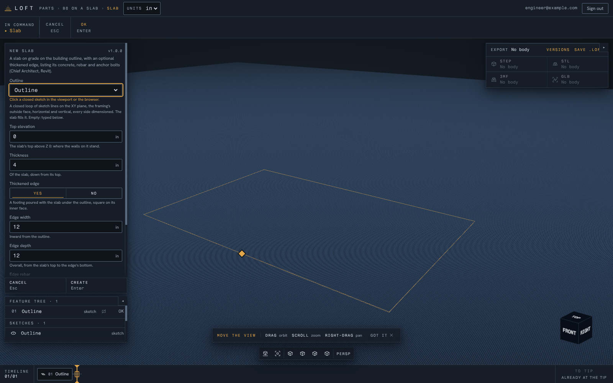
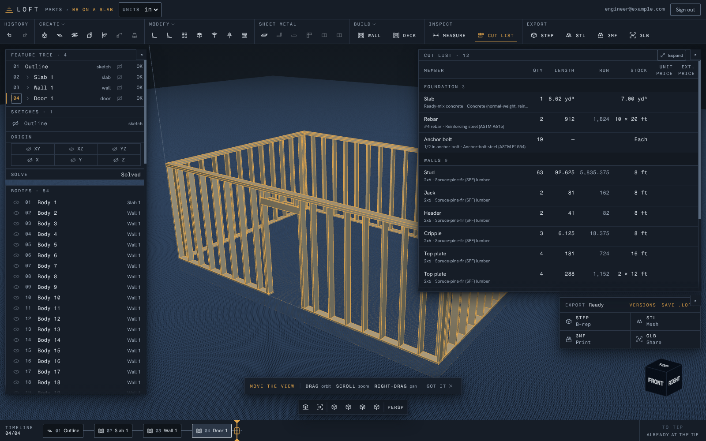

### Foundation (crawl space)

A poured stem wall on a continuous footing. The stem's outside face is the
outline. Pick the floor that stands on it as **Floor on it**. The floor is
unchanged: its sills sit on the stem's top at the floor's base elevation.

| Input               | Default | Notes                                       |
| ------------------- | ------- | ------------------------------------------- |
| Crawl height        | 24      | Grade to the joists' underside              |
| Stem thickness      | 8       |                                             |
| Footing             | 16 x 8  | Centred under the stem                      |
| Footing below grade | 12      | At least 12 (IRC R403.1.4)                  |
| Footing rebar       | 2 #4    | 3 in above the bottom and in from each face |
| Vents               | 16 x 8  | 72 in² net free area each, from the maker   |
| Access              | 24 x 16 | In the back wall by default                 |

It checks:

- **IRC R408.1 vents:** 1 ft² of net free area per 150 ft² of crawl, and one
  within 3 ft of each corner. Corner vents are centred 24 in from the corner.
- **IRC R408.4 access:** at least 24 x 16 and above grade. An opening that
  reaches below grade, into a corner or into another opening is refused.
- **IRC R317.1:** a crawl height under 18 in warns `crawl_height_low` (the
  joists then need to be treated or naturally durable). The foundation still
  builds.

**B9, B7 on a crawl space:** the footing is 118 784 in³ = 2.55 yd³, ordered
**2.75**. The stem, less its openings, is 188 544 in³ = 4.04 yd³, ordered
**4.25**. That is 7.00 yd³ in two deliveries. Rebar loops of 968 and 888 in
take **10 sticks**. The floor's sills take **18 bolts**. The cut list prices
**5 vents** and **1 access door** Each.

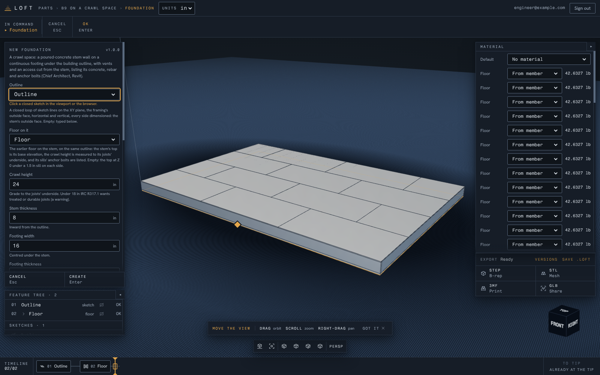
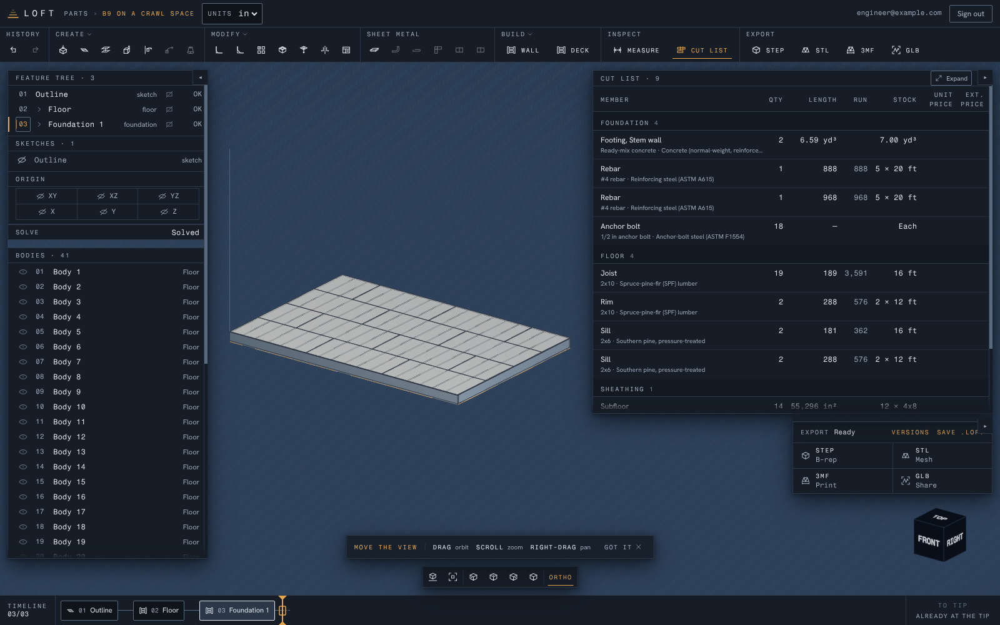

**Limits:** vents and access doors are priced with a steel placeholder
material. A stem is poured concrete only (no block).

## 3. Floors

### First floor

A platform floor: sill plates flat on the foundation, rims across the joist
ends, and joists on a layout with both end joists flush.

| Input          | Default       | B7                    |
| -------------- | ------------- | --------------------- |
| Outline        | none          | the outline           |
| Joists         | 2x8           | **2x10**              |
| Joist spacing  | 16            | 16                    |
| Joists bear on | Long walls    | Long walls (span 192) |
| Sill plate     | Yes, PT 2x6   | Yes                   |
| Subfloor       | 23/32 plywood | 23/32 plywood         |

**Joists bear on** picks the span: Long walls (the shorter span), Front and
back, or Left and right. The subfloor is 4x8 sheets with the long edge across
the joists, rows staggered 4 ft. A floor panel is never turned to fit an
offcut.

**B7:** 19 joists of 189 in, 2 rims of 288, PT sills 2 x 288 and 2 x 181.
The subfloor is 14 panels cut from **12 sheets**. The framing top is
10.75 in and the subfloor top 11.46875 in.

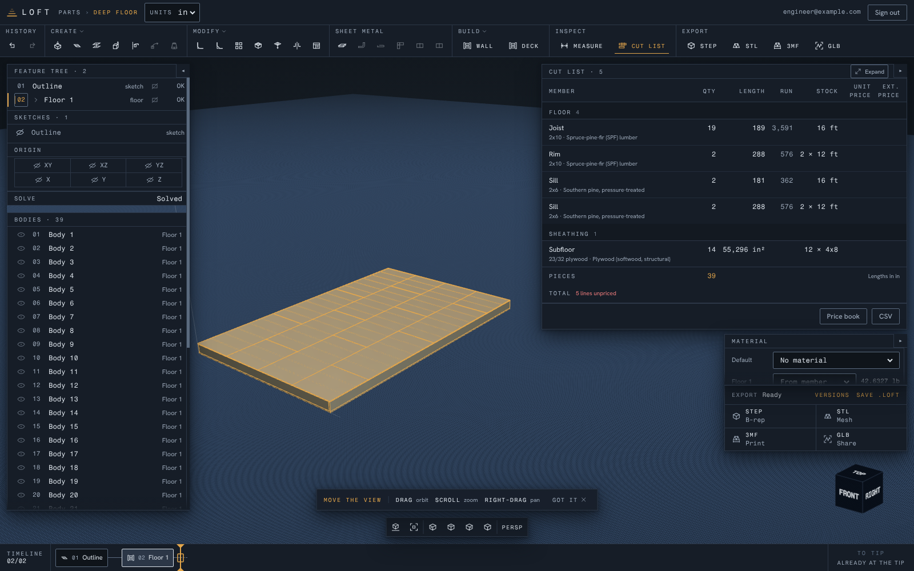

### Second floor and stairwell

A second Floor on the same outline, with **On walls** picking the walls below,
bears its rims on their top plates. It has no sills. Its base is the walls'
plate, so every picked wall must stand under it at one plate height.

Set **Stairwell** to Framed opening and type the opening's near corner and
size in the floor's frame. The defaults are B7's well: 43.5 x 120, its corner
18.25 along the width and 36 along the depth. The well is framed as IRC
R502.10 describes, at every size:

- trimmers doubled along both sides, rim to rim;
- headers doubled across both ends, between the inner trimmers;
- tail joists from each header to the rim, on the joist layout;
- the subfloor cut round the opening.

Then add a second Wall on the outline with **On floor** set to floor 2, and
put the roof on those upper walls.

**B7 two storeys:** floor 2 is floor 1 less its sills, raised 107.09375
(subfloor top 118.5625). The joists at X 32 and 48 become 4 tails of 31.5 on
4 header plies of 43.5. The golden `b7-second-floor` is 470 bodies.

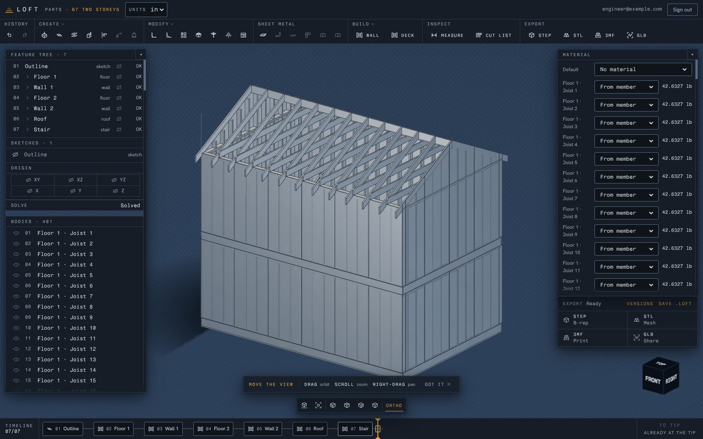
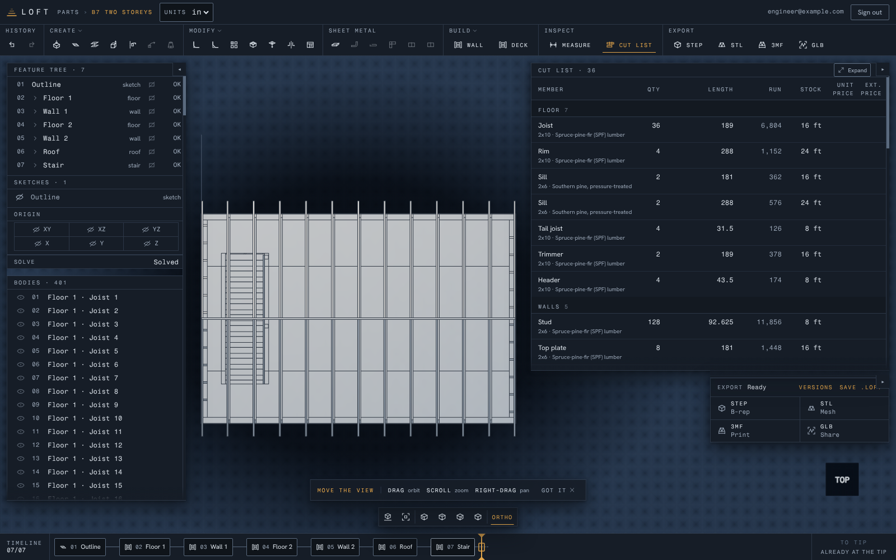

**Limits:**

- Joist hangers are not listed yet (B7's well wants 4 single and 4 double).
- The band between storeys gets no OSB, so siding stands 7/16 in proud of
  the rim.
- A stair through the well checks headroom only against an opening you type
  on the stair (see [Stairs](#stairs)).
- A part is limited to 1 500 features counted after expansion. B7 at two
  storeys is 1 078.

## 4. Walls, openings and partitions

### Walls

Pick the outline as **Outline** and the floor (or slab) as **On floor**. One
Wall feature then frames a wall on every outline line. Walls along the first
line run through at the corners. The others fit between them. Studs lay out
from each wall's start at the spacing, with an end stud flush at the far end.

| Input              | Default | B7           |
| ------------------ | ------- | ------------ |
| Height             | 97.125  | 97.125       |
| Studs              | 2x4     | **2x6**      |
| Stud spacing       | 16      | 16           |
| Top plate          | Double  | Double       |
| Bottom plate       | PT      | PT           |
| Exterior sheathing | None    | **7/16 OSB** |
| Inside gypsum      | None    | None         |
| Exterior finish    | None    | None, or Lap |

Sheathing runs the wall's full height in 48 in panels from the wall's start,
the rough openings cut out. At each outside corner the fitted wall's
sheathing laps the through wall's end.

**B7:** front and back 288, sides 181. 60 full studs of 92.625. The 97.125 in
walls are taller than 96, so the OSB is 24 panels cut from **21 4x9 sheets**.

**Limits:** plates are butted at corners, not lapped. There are no steel
studs and no insulation yet.

### Windows and doors

A Window or Door picks its **Host wall** and, on an outline, its **Wall** by
side (Front, Back, Left, Right). The wall frames it: kings, jacks, a header,
top cripples and, for a window, a flat sill with bottom cripples. A door cuts
the bottom plate.

| Input         | Window default    | Door default         |
| ------------- | ----------------- | -------------------- |
| Size          | 3040              | 3068                 |
| Measured from | Nearer the origin | Nearer the origin    |
| Head height   | 82.5              | (stands on the base) |
| Header        | 2x6               | 2x6                  |
| Header build  | Fill the wall     | Fill the wall        |
| Unit          | Frame and glass   | Frame and slab       |

A call size sets the rough opening: a 3068 door is 36 x 80 with a 38 x 82.5
rough opening, and a 3040 window 36 x 48. **Custom** takes a typed size and
rough-opening allowance. **Fill the wall** builds as many header plies as fill
the wall, with 1/2 in plywood spacers between them: in a 2x6 wall, 3 plies
and 2 spacers. **Two plies, foam between** puts rigid foam in the gap.

Units are listed Each under Walls, one line per kind and size.

**B7:** the door and two 3040 windows on Front at Distance 144, 60 and 228; a
3040 on Back at 144; a 2030 on Left and on Right at 90.5 (the centre of a
181 in side wall). Headers are 41 over the door, 39.5 over each 3040 and
27.5 over each 2030. The 12 spacers come from one 4x8 sheet of 1/2 plywood.

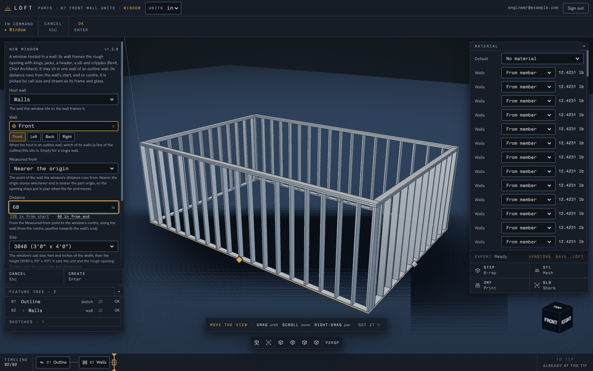

**Limits:** foam in an insulated header is listed but not priced. Changing
**Measured from** moves the opening instead of keeping it in place.

### Interior walls (partitions)

Add lines to the outline sketch (or a separate plan sketch) and add one
**Interior wall** feature that picks the exterior walls. Each line becomes a
partition centred on it, running to the first wall or partition each way.
Partitions follow the house when the outline is resized. Studs lay out from
the end the line was drawn from.

| Input         | Default            |
| ------------- | ------------------ |
| Studs         | 2x4 at 16          |
| Top plate     | Double             |
| Backing       | Ladder blocking    |
| Gypsum        | 1/2 in, both faces |
| Gypsum sheets | 4x8                |

**Backing** (IRC R702.3.5: every board edge fastened) is framed in the wall a
partition meets. **Ladder blocking** places flat blocks across the bay
between the studs either side, every 24 in up (three on a 92-5/8 stud).
**Three-stud corner** adds two full studs instead.

Doors in a partition are Door features that pick the Interior wall and the
partition.

**B10, B7 with two partitions:** P1 at X 180 runs back to front; P2 at Y 132
runs from the right wall to P1, with a 2868 door. The walls frame **4
ladders, 12 blocks**. The 20 gypsum panels are cut from **12 4x8 sheets** (11
by area).

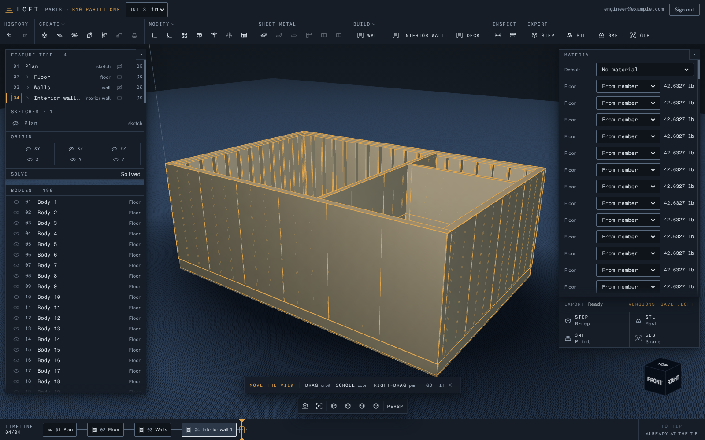

**Refused**, naming the line: a line that is not horizontal or vertical or not
fully defined; a partition that meets no wall one way, meets a wall at its
end or corner, meets another partition end to end, crosses one or overlaps
framing; backing that lands in an opening's framing; and an Interior wall
added after a Ceiling on the same walls.

**Limits:** no L or crossing partitions and no free ends yet.

## 5. Roof

One **Roof** feature picks the **Walls** and, on an outline, the walls that
**Define slope**. Plate height and width are read from the walls.

| Input          | Default             | B7                        |
| -------------- | ------------------- | ------------------------- |
| Style          | Gable               | Gable                     |
| Defines slope  | (all walls)         | Front, Back               |
| Pitch          | 6/12                | 6/12                      |
| Rafter spacing | 24                  | 24                        |
| Eave overhang  | 12 (horizontal)     | 12                        |
| Rafters        | 2x6                 | **2x8**                   |
| Ridge board    | 2x8                 | **2x10**                  |
| Hips, Valleys  | 2x8                 |                           |
| Ceiling joists | Beside each common  | Beside each common        |
| Gable ends     | Studs and sheathing | Studs and sheathing       |
| Roofing        | None                | None, or Asphalt shingles |

Rafters have a birdsmouth on the plate and a plumb-cut tail. The seat takes
the full plate unless the heel would pass 1/3 of the rafter's depth. The cut
list gives each rafter's overall length, long point to long point.

**Gable or hip.** Gable: two opposite walls define the slope. Hip: every wall
does (leave Defines slope empty). A hip on an L-shaped outline frames its
valleys and valley jacks. Hips are dropped and valleys are not.

**IRC R802.3:** the ridge board must be at least as deep as the rafters'
plumb cut, or the roof is refused. B7's 2x8 rafters at 6/12 have an 8.106 in
plumb cut, deeper than a 2x8, so its ridge is a 2x10.

**B7 rafters:** 26 rafters at 123.5341 overall on 12 ft stock and one
288 in ridge.

### Ceiling joists

**Beside each common** (IRC R802.5.2: rafter ties) puts one joist on the
bearing walls' plates beside every inner common pair, its top corners snipped
to the roof plane. A joist is one piece wall face to wall face. If the joist
would pass the ridge board's underside, the roof builds without joists and
warns `ceiling_joists_omitted`, naming the deepest joist that fits.

**B7:** **11** 2x8 joists of 192 in, each on one 16 ft stock (13 at 28 ft).

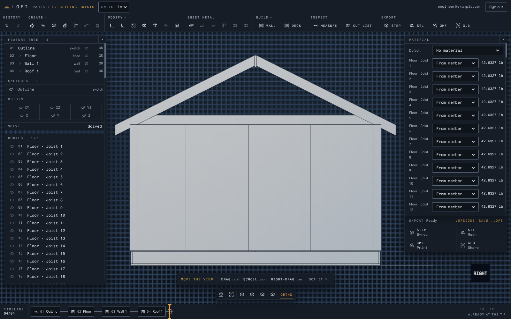

### Gable ends

**Studs and sheathing** frames each end wall's triangle: a stud at each of
the wall's inner layout centres, cut on the slope to the rafters' underside,
and the wall's sheathing carried up to the roof plane. If the walls have an
Exterior finish, the siding goes up the gable too.

**B7:** **22** gable studs (2 of each of 11 lengths) and 12 OSB panels cut
from **4 4x8 sheets**.

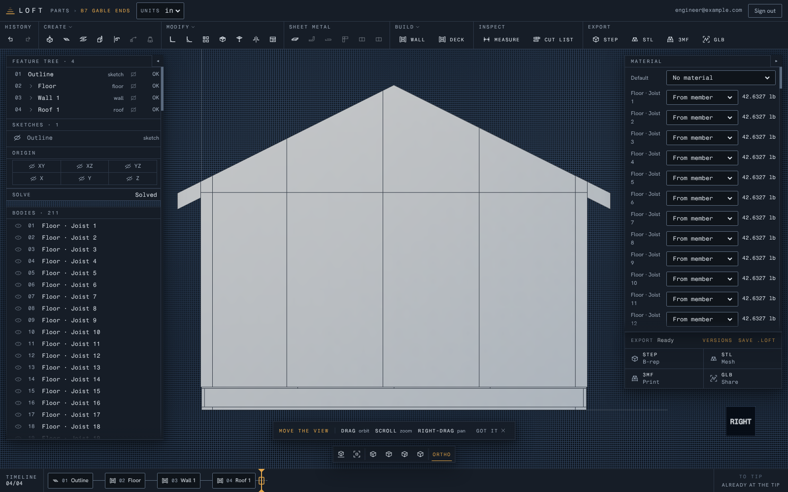

### Roofing

**Asphalt shingles** builds and lists the covering of a gable on its walls:

- a 7/16 OSB deck from the fascia's face to the ridge line, in 48 in courses
  staggered 4 ft, every end joint centred on a rafter;
- a fascia, the narrowest 1x board that covers the tails' plumb cut;
- a 1x6 rake board up each rake;
- listed, not drawn: architectural shingles at 3 bundles a square plus the
  **Roofing waste** (10%), synthetic underlayment in 10-square rolls, drip
  edge in 10 ft sticks lapped 2 in, starter on the eaves and ridge cap by the
  foot.

**B7 at 6/12:** each plane is 121.5862 on the slope by 288.875, 70 246.42 in²
= 4.8782 squares in all.

| Item         | B7 buys                                   |
| ------------ | ----------------------------------------- |
| Deck         | 24 panels from **21** 4x8 OSB sheets      |
| Shingles     | 4.8782 x 1.10 x 3 = 16.10: **17 bundles** |
| Underlayment | **1 roll**                                |
| Drip edge    | 1 064.09 in: **14 sticks**                |
| Starter      | 48.15 ft: **49 ft**                       |
| Ridge cap    | 24.07 ft: **25 ft**                       |
| Fascia       | 1x10, 4 pieces on four 14 ft sticks       |
| Rake boards  | 1x6, 4 on 12 ft                           |

At 8/12 the roof takes 18 bundles. The golden `b7-roofing` (B7 sided and
roofed) is 361 bodies.

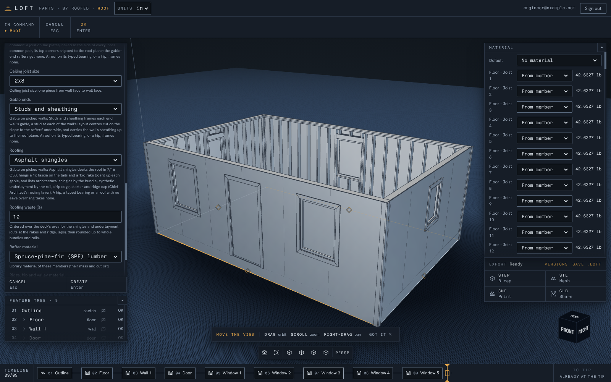
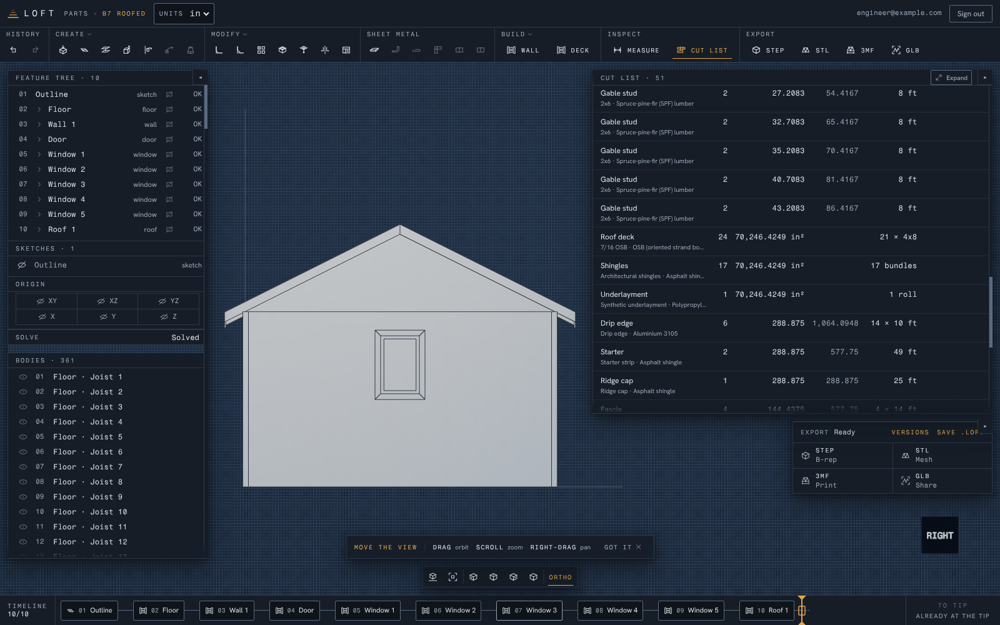

**Roof limits:**

- A hip frames no ceiling joists and no gable ends, and takes no roofing
  yet. A Ceiling refuses a hip.
- Gable roofs have no rake overhang, and there is no shed roof yet.
- A gable with Roofing but no eave overhang builds unroofed and warns
  `roof_roofing_no_overhang`.
- Starter and ridge cap are bought by the foot, not by the bundle.
- A ceiling joist is never spliced, so past 24 ft it lists no stock.

## 6. Siding

**Exterior finish** on the Wall (None by default) hangs siding over the
sheathing. A wall with a finish but no sheathing builds bare and warns
`wall_finish_no_sheathing`.

| Finish                             | Bought by         |
| ---------------------------------- | ----------------- |
| Lap, fibre cement 8-1/4 in at 7 in | 12 ft boards      |
| Vinyl, double 4 in                 | squares (100 ft²) |
| Cedar bevel 1/2 x 8 at 6-1/4 in    | 12 ft boards      |

Siding runs from the foundation top to the top plate, so on a floor it covers
the rim. It is bought by its measured net area plus **Siding waste** (10%).
Each outside corner of an outline gets two 5/4x4 corner boards. Each window
and door gets 5/4x4 picture-frame casing. Trim is nested on stock.

**B7 in fibre-cement lap**, gables included: 99 778.90 in² x 1.10 / 1 008 =
108.89, **109 boards**. 8 corner boards on 10 ft. The casing is 23 pieces,
1 099.5 in, on **14** 8 ft sticks. In vinyl B7 takes 8 squares; in cedar,
122 boards.

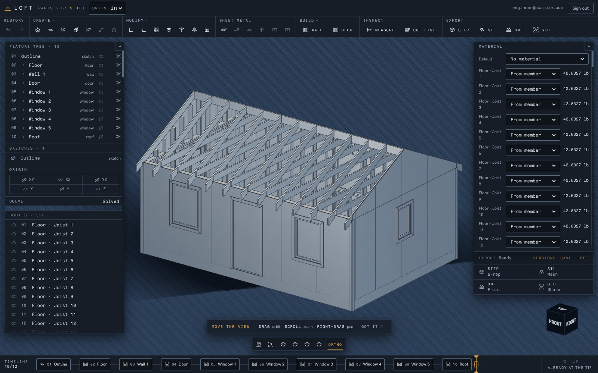
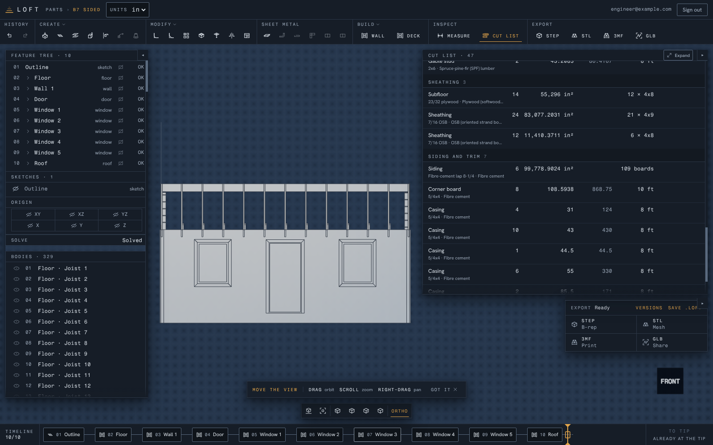

**Limits:** a typed (non-outline) wall gets no corner boards. Inside corners
get no trim. Fibre-cement lap is modelled as a flat 5/16 in board, about 15%
lighter than the maker's weight.

## 7. Drywall and ceiling

**Walls.** **Inside gypsum** on a Wall (1/2 in, or 5/8 in Type X; 4x8 or
4x12 sheets) hangs board horizontally in 48 in courses down from the top
plate, the openings cut out. A partition's Gypsum does the same on both
faces. Board is bought by the sheets it is cut from, not by area.

**Ceiling.** Add a **Ceiling** after the roof and pick the roof. It hangs one
layer under the ceiling joists, across them, every end joint on a joist.

| Input  | Default                               |
| ------ | ------------------------------------- |
| Board  | 1/2 in ceiling gypsum (sag-resistant) |
| Sheets | 4x12                                  |

**B7:** 277 x 181 (348.17 ft²) in three 48 in courses and a 37 in rip, each
course 140 + 137 with the joint on the joist at X 145.5: **8 sheets** of 4x12.
Under B10 the partitions and their board are cut out: 13 panels.

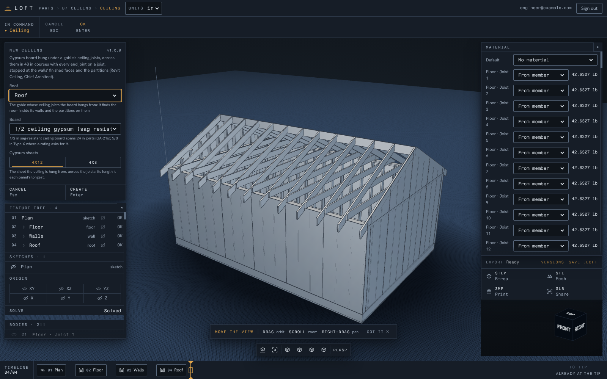
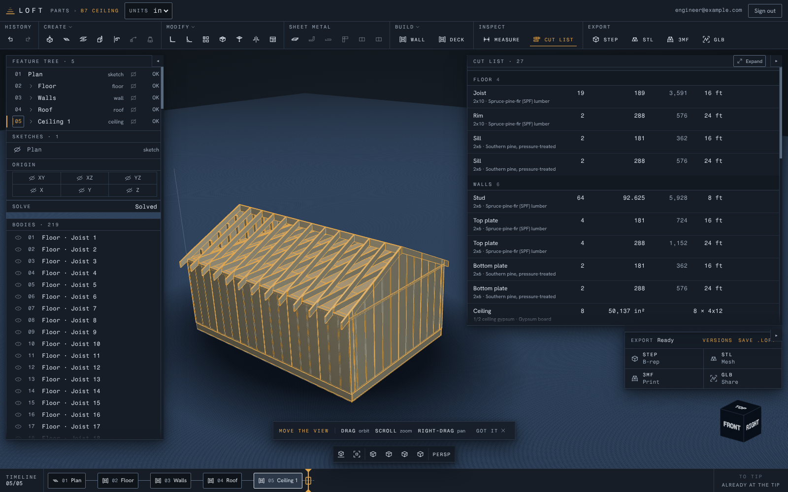

**Refused:** a roof that is not a gable on an outline, a roof before 1.6.0,
Ceiling joists set to None or not framed, and joists farther apart than a
sheet is long.

**Limits:** ceiling board is listed under Walls. Every course's end joint
lands on the same joist. Wall board runs to the top plate, so each ceiling
edge stops 1/2 in short of the framing.

## 8. Cabinets

**Cabinets** places a run of boxes on a wall's or a partition's finished
face. The run is an ordered list of boxes, each Base, Wall, Tall, Vanity or
Filler. A box is 9 to 48 in wide in 3 in steps; a filler is any width.

| Input           | Default                       |
| --------------- | ----------------------------- |
| Construction    | Frameless                     |
| Carcass         | 3/4 plywood (or 3/4 melamine) |
| Wall box bottom | 54                            |
| Boxes           | one 24 in Base                |

Standard boxes: base 34.5 high and 24 deep, wall 12 deep (30, 36 or 42
high), tall 24 deep (84, 90 or 96), vanity 21 deep. Every panel is a body.
The cut list lists them under Casework: sheets with their grain, edge banding
by the foot, hinges and drawer slides Each.

**C2, a kitchen on B10's left wall** with inside gypsum: a base run (filler
3, T1884, DB24, B27, SB36 centred under the window, B24) from the back wall's
board, and a wall run (W2430, W2730) with its bottom 54 in up: **91 panels**,
26 266.109 in³ ([`casework.md`](./reference-parts/casework.md)).

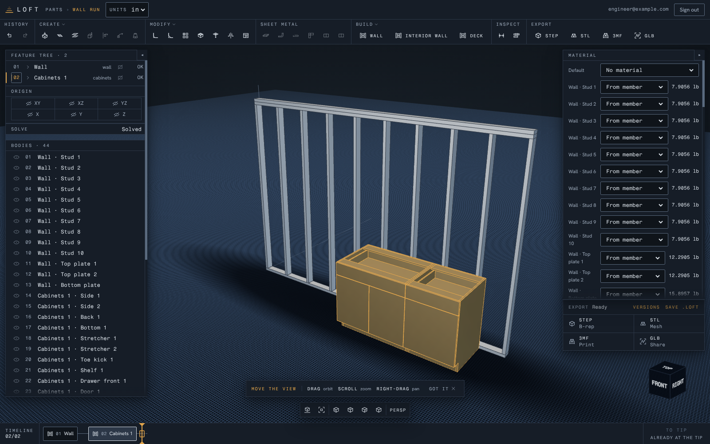

**Limits:** these are shop models, not joinery: panels butt, and dados,
dowels, screws and hinge cups are not modelled. A run that would pass a
partition is refused. Hinges and slides are priced under one steel material.

## 9. Decks, footings and stairs

### Deck

| Input              | Default                              |
| ------------------ | ------------------------------------ |
| Width x Projection | 192 x 144 (16 x 12 ft)               |
| Height             | 30 (decking top)                     |
| Support            | Ledger on the house                  |
| Joists             | 2x10 at 16, away from the house      |
| Beam               | 2 plies 2x10, dropped, 18 in setback |
| Posts              | 6x6, at most 96 apart                |
| Decking            | 5/4x6, 1/8 in gaps                   |
| Guard              | None                                 |
| Footings           | Round pier under each post, 16 x 12  |
| Footing concrete   | 80 lb bags                           |
| Post bases         | Yes                                  |

Joists along the house need a freestanding deck. The guard (on the open
sides) uses 4x4 posts at most 6 ft apart, 2x4 rails with the top 36 in up,
and 2x2 balusters with no gap over 4 in (IRC R312). With a stair on the deck,
the guard opens between the stair's stringers.

**B1, the defaults:** 13 joists of 141, ledger, rim and two beam plies of 192,
3 posts of 10.5, 26 deck boards of 192. 3 piers: 4.19 ft³ x 1.05 / 0.60 ft³
a bag = 7.33, **8 bags** and **3 post bases**.

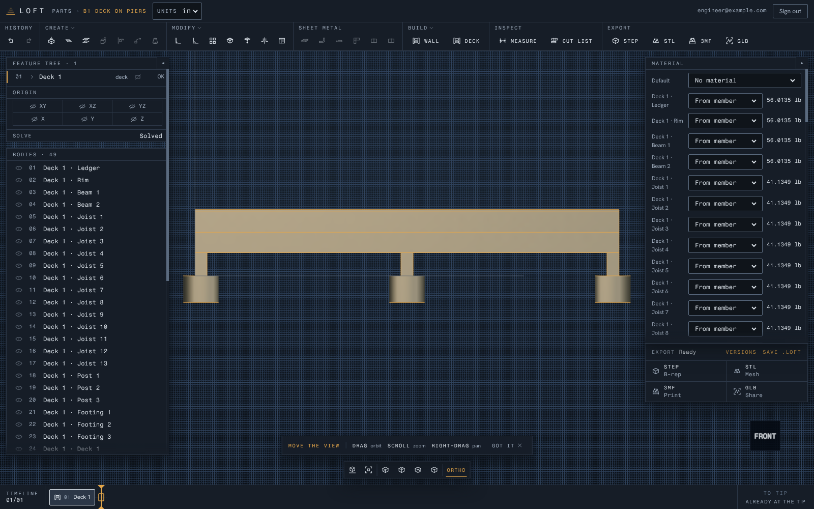
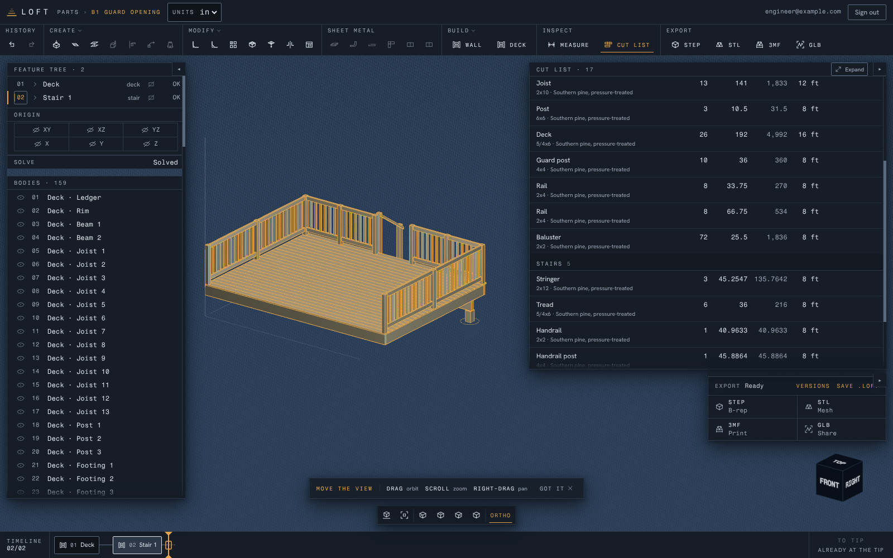

**Limits:** the post base's standoff is not modelled. A corner pier
overhangs the deck's edge in plan.

### Stairs

A **Stair** is hosted on a deck edge (pick the deck, an edge and a position)
or free (type the total rise, the top nosing point and the direction).
Risers are equal: ceil(rise / maximum riser). There is one tread fewer than
risers.

| Input         | Default                    |
| ------------- | -------------------------- |
| Width         | 36                         |
| Maximum riser | 7.75                       |
| Tread depth   | 11                         |
| Stringers     | 2x12, cut                  |
| Treads        | 5/4x6                      |
| Risers        | Open                       |
| Handrail      | Left, 36 above the nosings |

**Refused** (the message starts with the section): IRC R311.7.1 width under
36; R311.7.5.1 a riser over 7-3/4, or open risers that pass a 4 in sphere
more than 30 in up; R311.7.5.2 a tread under 10, or a top step more than 3/8
off the others; R311.7.5.3 nosing out of range; R311.7.8 no handrail on 4 or
more risers; R311.7.8.1 a handrail outside 34 to 38; R311.7.2 headroom under
6 ft 8 in below a typed **Stairwell opening**.

**Warned:** a stringer throat under DCA6's 5 in (`stair_throat_thin`), a
stringer spanning more than 6 ft (`stair_stringer_span`), open sides more
than 30 in up with no guard (`stair_guard_required`, IRC R312.1.1).

**B1's stair** at X 96: 4 risers of 7.5 and 3 treads of 11. 3 stringers,
each 45.2547 in on 8 ft stock, with a 5.0533 in throat.

**B7's interior stair**, free, through the second floor's well: rise
107.09375, closed risers, 14 risers of 7.649554 and 13 treads of 10. With the
stairwell opening typed as 118.125 in, the headroom is **80.39 in**, just
over R311.7.2's 80.

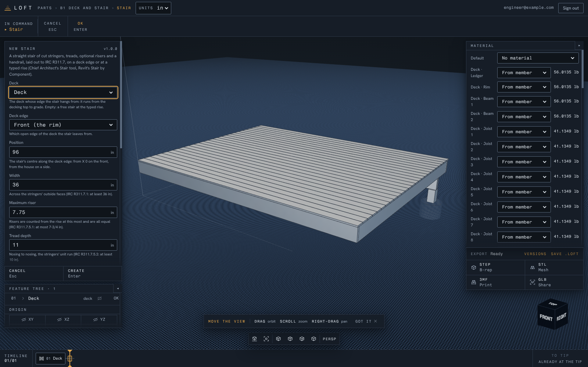
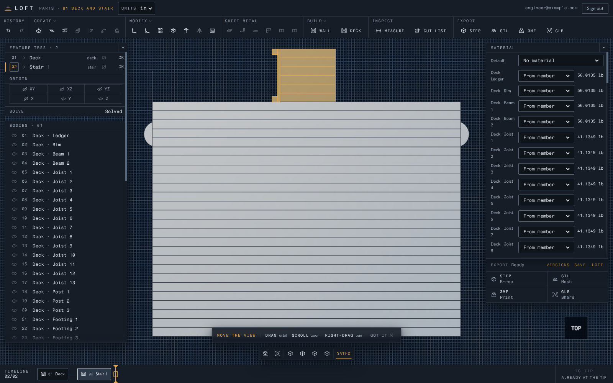

**Limits:** a deck stair has no landing pad, and its rail posts stand on
grade. A stair frames no guard of its own. A free stair's handrail stands on
posts, not wall brackets.

## 10. Update all

Each Build feature stays on the release it was made with. When a newer
release can take its inputs, the tree shows an **UPDATE** badge on its row,
"N Build features out of date" and an **Update all Build features** button.

- The badge names what the update adds ("adds 11 ceiling joists").
- An update that changes no member gets no badge, but Update all takes it.
- An update that would re-lay members the feature already built is offered
  on that feature alone ("Update to x.y.0" in its editor). Update all leaves
  it and says why.
- An update adds what the new release frames (ceiling joists, gable studs,
  pier footings, header spacers). It never adds siding or roofing.
- One **Ctrl+Z** undoes the whole Update all.

**B7 saved at older releases:** 7 features are out of date (the door, five
windows and the roof). One Update all adds each header's middle ply and two
spacers, 11 ceiling joists, 22 gable studs and 12 gable panels. The result is
the golden `b7-update-all`, 280 bodies.

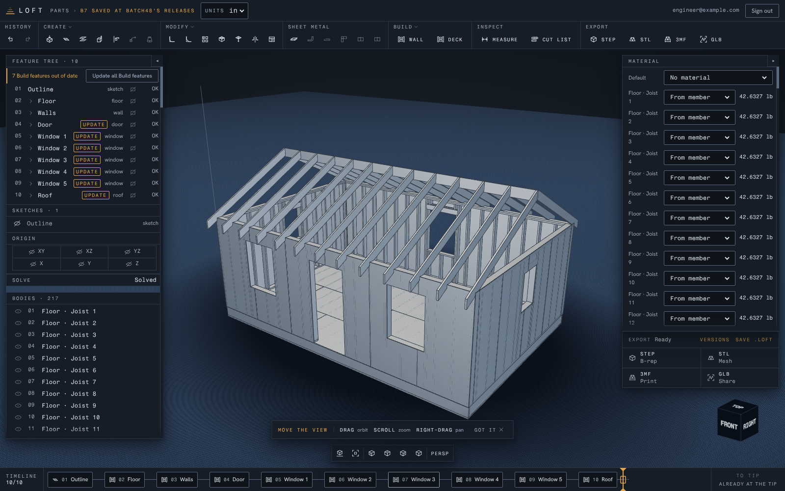

Releases with no update path: Wall 1.0.0, Deck 1.0.0, Floor 1.0.0 and 1.1.0,
and Roof 1.0.0 and 1.1.0.

## 11. Cut list, price book and drawings

**Cut list.** Inspect > **Cut list** groups every member by system
(Foundation, Floor, Walls, Roof, Sheathing, Siding and trim, Deck, Stairs,
Frame, Casework), then by member, profile, material and length. Lengths are
measured from the bodies. Lumber gets the shortest stock length that covers
it, up to 24 ft for dimension lumber. When pricing, a plate, rim or ridge
over 20 ft whose stock your book does not price is spliced from lengths it
does: B7's 288 in rims become 16 + 8 ft. A joist, rafter, hip, header, beam,
stud or post is never spliced. Sheet goods are bought by the sheets their
panels are cut from. **CSV** downloads the same lines.

**Price book.** Each user has one price book, empty at first. Price a line
in the unit it is sold in: Each (a stock piece, sheet, unit, bag, bundle,
roll or stick), per linear foot, per board foot, per cubic yard, or per
square. Click a blank price to open the Price book with that line's
material, profile and stock filled in. A line with no price stays blank,
never $0, and the total counts the unpriced lines.

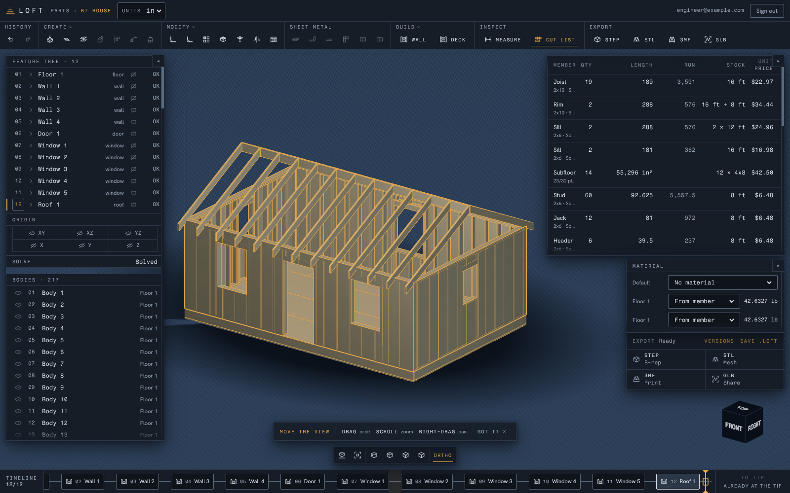

**Drawings.** Create > **Drawing** on the part, then **House set** (H) lays
out on ANSI B at 1:48:

- a plan cut 48 in above the lowest floor, with exterior strings to the
  opening centres;
- four elevations with the plate and window heads dimensioned;
- the materials list: the cut list as a yard order, line for line and to the
  cent.

**B7's plan:** 24'-0" x 16'-0" overall; the front string 5'-0", 7'-0",
7'-0", 5'-0"; the back 12'-0" + 12'-0"; each side 8'-0" + 8'-0". The
elevations give the plate at 8'-1 1/8" and the heads at 6'-10 1/2" above the
subfloor.

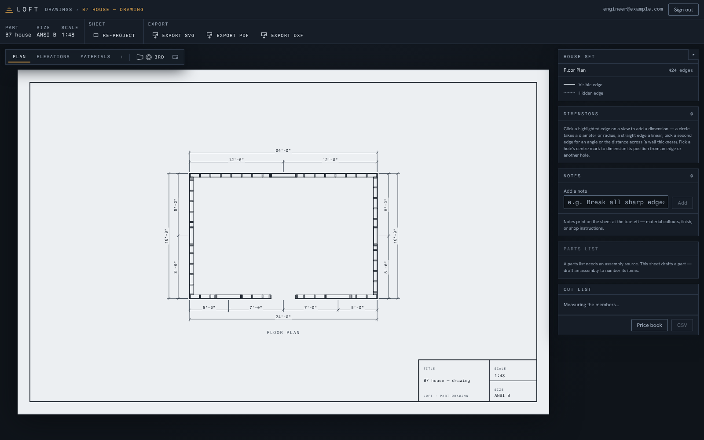
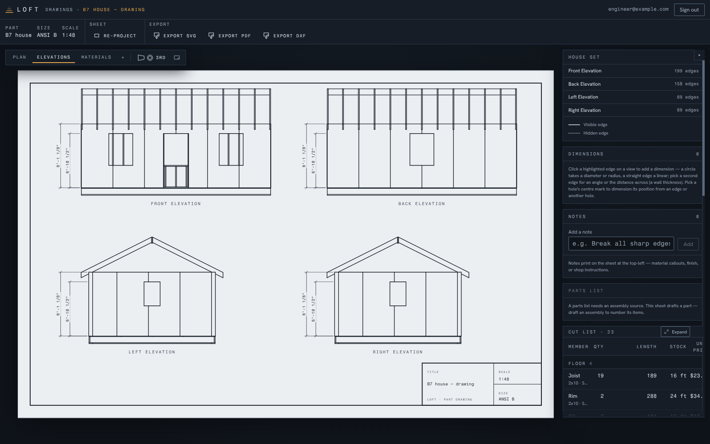

**Limits:** elevations have no width strings. An L-shaped plan is strung as
its bounding box. Base cabinets and steps below the cut are not drawn. The
yard order repeats a stock size that appears on several cut-list lines.

## Limits across every tool

- A part has no interference check in the app. The reference buildings'
  acceptance tests check their exported STEP for it.
- A part is capped at 1 500 features after expansion.
- No insulation, electrical or plumbing yet.

What is next is in [`BACKLOG.md`](./BACKLOG.md). How plugins, versions and
updates work is in [`ARCHITECTURE.md`](./ARCHITECTURE.md#build-features-plugins).
